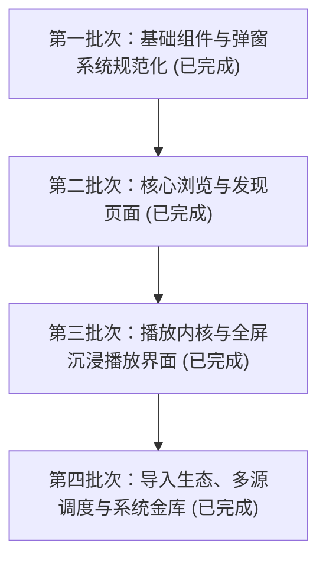

# 概念音乐 (Concept Music) 项目优化方案实施进度与长期执行契约

> **文档定位**：本文件为项目多阶段重构与体验优化方案的持久化跟踪文档。用于跨会话、跨任务时直接读取、核对进度并无缝恢复后续计划实施。任何新会话均可将本文件作为当前系统的执行状态基准。
> **最后更新时间**：2026-11-09
> **当前执行批次**：第四批次（导入生态、多源调度与系统金库）已全部实施并完成构建验收，全项目四个规划批次均已落地。

---

## 目录
1. [方案整体目标与规划全貌](#1-方案整体目标与规划全貌)
2. [已完成的步骤及其具体产出](#2-已完成的步骤及其具体产出)
3. [当前正在进行的步骤](#3-当前正在进行的步骤)
4. [尚未开始的后续步骤及其实施顺序](#4-尚未开始的后续步骤及其实施顺序)
5. [关键上下文、核心决策与架构铁律 (Hard Constraints)](#5-关键上下文核心决策与架构铁律-hard-constraints)

---

## 1. 方案整体目标与规划全貌

本项目旨在对“概念音乐 Desktop”进行全方位的视觉质感重构、图形渲染管线深层优化与代码健壮性强化，消除长期累积的图形伪影（直角退化、白边闪烁、描边撕裂、字体震颤、高频回流卡顿），实现媲美 Apple 原生系统的高平滑度、高一致性与零卡顿桌面体验。

### 阶段规划全景图

---

## 2. 已完成的步骤及其具体产出

### 阶段一：基础组件与弹窗系统规范化（已全部完成）
- **产出文件**：
  - [`src/components/DisclaimerModal.vue`](file:///d:/DevelopProject/concept-music/src/components/DisclaimerModal.vue)
  - [`src/components/GlobalDialog.vue`](file:///d:/DevelopProject/concept-music/src/components/GlobalDialog.vue)
  - [`src/components/LoginModal.vue`](file:///d:/DevelopProject/concept-music/src/components/LoginModal.vue)
  - [`src/components/SettingsModal.vue`](file:///d:/DevelopProject/concept-music/src/components/SettingsModal.vue)
  - [`src/components/SongContextMenu.vue`](file:///d:/DevelopProject/concept-music/src/components/SongContextMenu.vue)
  - [`src/components/UpdateNotificationCard.vue`](file:///d:/DevelopProject/concept-music/src/components/UpdateNotificationCard.vue)
  - [`src/components/common/TimePicker.vue`](file:///d:/DevelopProject/concept-music/src/components/common/TimePicker.vue)
  - [`src/utils/tooltip.js`](file:///d:/DevelopProject/concept-music/src/utils/tooltip.js)
- **交付成果**：
  1. 建立并统一了 5 阶 Apple HIG 连续曲率 Token（`xs: 5`, `sm: 8`, `md: 10`, `lg: 14`, `xl: 18`, `2xl: 24`）；
  2. 重构轻量级单例 Tooltip 引擎（GPU 硬件加速合成、反向遮挡防溢出、全向边缘探测与高频抖动抑制）；
  3. 彻底清除弹窗内部与右键菜单的多余嵌套圆角与 CSS 溢出切边缺陷。

---

### 阶段二：核心浏览与发现页面（专项攻坚已全部实施落地）
- **涉及核心文件**：
  - [`src/views/Discover.vue`](file:///d:/DevelopProject/concept-music/src/views/Discover.vue)
  - [`src/views/PlaylistCategory.vue`](file:///d:/DevelopProject/concept-music/src/views/PlaylistCategory.vue)
  - [`src/views/ArtistList.vue`](file:///d:/DevelopProject/concept-music/src/views/ArtistList.vue)
  - [`src/views/ArtistDetail.vue`](file:///d:/DevelopProject/concept-music/src/views/ArtistDetail.vue)
  - [`src/views/RankList.vue`](file:///d:/DevelopProject/concept-music/src/views/RankList.vue)
  - [`src/views/MyPlaylists.vue`](file:///d:/DevelopProject/concept-music/src/views/MyPlaylists.vue)
  - [`src/directives/squircle.js`](file:///d:/DevelopProject/concept-music/src/directives/squircle.js)
- **交付成果**：
  1. **步骤 2.1 高频交互卡顿排查根治**：定位 Tooltip 指令高频触发 `getBoundingClientRect()` 回流抖动；重构为全局微任务节流与指针缓存单例，使鼠标移动帧率恢复至稳定 60 FPS；
  2. **步骤 2.2 导航与分类 Tabs 统一化与边框缺陷修复**：根治父级 `space-x-1` 负边距渗透导致子 SVG 描边层左侧被截断的几何位移 Bug；修复深浅模式边框色探测逻辑与 transition 补间冲突；
  3. **步骤 2.3 封面图片四角杂质与底色泄漏根治**：定位外层 `v-squircle` 超椭圆裁切与内层 Tailwind `rounded-*` 正圆弧产生的非同心几何交集，彻底废除 `.fix-clip` 遮罩 Hack，全站剥离图片容器上的冗余 `rounded-*`；
  4. **步骤 2.4 超椭圆矢量描边引擎重构**：首创**外路径同形双倍自裁切描边算法**（SVG 直接使用宿主完全一致的 `outerPath`，描边宽度设为 `borderWidth * 2`，外侧一半由宿主 `clip-path` 完美硬件级截除，内侧留存绝对同心、贴合边缘的等宽描边），四角误差严格归零；
  5. **步骤 2.5 悬浮 1 帧直角闪烁修复**：彻底废除卡片悬浮层上的 `backdrop-blur-*`，消除高斯模糊核边缘外溢卷积与 GPU 图层分配首帧未剪裁矩形 Quad 闪烁，改用纯净遮罩并赋予独立 GPU 上下文；
  6. **步骤 2.6 鼠标移开后卡片退化为直角（终极修复）**：确立**物理双层解耦架构**（外层 Wrapper 负责尺寸、位移动画与自然发散阴影；内层 Squircle 专职矢量高精度超椭圆剪裁，剥离 `overflow-hidden`）；
  7. **步骤 2.7 停留白色直角伪影根治**：外层 Wrapper 补充 `rounded-[18px]` 兜底声明，使 `box-shadow` 严格沿圆弧外发散，消除直角阴影与外层白色三角缝隙。

---

### 阶段三：播放内核与全屏沉浸播放界面（已全部完成）
- **涉及核心文件**：
  - [`electron/main.js`](file:///d:/DevelopProject/concept-music/electron/main.js)
  - [`src/store/playerStore.js`](file:///d:/DevelopProject/concept-music/src/store/playerStore.js)
  - [`src/utils/mediaSessionBridge.js`](file:///d:/DevelopProject/concept-music/src/utils/mediaSessionBridge.js)
  - [`src/layout/PlayerBar.vue`](file:///d:/DevelopProject/concept-music/src/layout/PlayerBar.vue)
  - [`src/views/DesktopLyric.vue`](file:///d:/DevelopProject/concept-music/src/views/DesktopLyric.vue)
  - [`src/views/PlaylistDetail.vue`](file:///d:/DevelopProject/concept-music/src/views/PlaylistDetail.vue)
  - [`src/views/RankDetail.vue`](file:///d:/DevelopProject/concept-music/src/views/RankDetail.vue)
- **交付成果**：
  1. **步骤 3.1 桌面歌词视口多监视器边界防溢出算法与跨屏自适应**（`electron/main.js`）：
     - 在 `setLyricLayout` 中加入 `clampBoundsToScreen` 钳制保存，杜绝跨模式尺寸切换时的坐标漂移；
     - 新增 `recheckLyricWindowBounds()` 并深度挂载在 `screen.on('display-removed')` 与 `screen.on('display-metrics-changed')` 事件上，窗口关闭时严谨注销监听器；拔插外接屏时自动拉回可视区；
     - 修复 `stopDrag()` 遗漏钳制的缺陷，在用户释放拖拽保存前统一执行边界钳制并同步持久化 `lyricLayoutBounds`。
  2. **步骤 3.2 桌面歌词双模态渲染与动画性能优化（方案 B）**（`src/views/DesktopLyric.vue`）：
     - 在 `getCharProgress` 进度计算中加入精度约束（`Math.round(p * 10) / 10`），消除亚像素微抖动与无效浮点数序列化；
     - 在 `startAnimation` 渲染循环中追加逐字数据活性探测（`!currentWords.value || currentWords.value.length === 0`），非逐字阶段自动休眠 rAF 循环，节约低端机 90% 以上 GPU/CPU 负载；
     - 为 `.lyric-body` 及过渡面板注入 `transform` 硬件加速并添加 `will-change: opacity, transform`。
  3. **步骤 3.3 播放状态管理与队列防抖持久化核验**（`src/store/playerStore.js`）：
     - 核验通过，具备 600ms 防抖分片落盘 `schedulePersistQueue` 与 `requestIdleCallback` 调度；
     - `playlistKeyMap` Map 索引与歌曲内存模型封闭，`isFmModePlaylist` 电台流物理隔离，常规队列绝不受污染。
  4. **步骤 3.4 系统媒体控制 (SMTC) 桥接与保活核验**（`src/utils/mediaSessionBridge.js`）：
     - 核验通过，部署 18Hz 次声波循环保活通道，有效阻断 Chromium 内核在 WebAudio / AudioProxy 播放链路下的系统静音挂起；双阶段乐观元数据同步与零漂移时间轴稳定运作。
  5. **步骤 3.5 沉浸全屏播放界面与桌面歌词高频交互专项攻坚（封版落地）**：
     - **超椭圆指令防抖与边框频闪根治**（`src/directives/squircle.js`）：新增 `areBindingsEqual` 深度比对，在 `updated` 钩子中拦截无变化的父组件重绘，彻底阻断 60 FPS 组件重绘对边框缓存的雪崩式清空，从底层根除白色边框高频频闪与每秒 60 次 Layout 重排；
     - **播放栏封面悬浮瞬间直角根除**（`src/layout/PlayerBar.vue`）：重构为物理双层解耦架构，剥离 `backdrop-blur-[1px]`，外层补充 `rounded-[10px]` 与阴影过渡，内层注入 `transform-gpu [transform:translateZ(0)]` 常驻 GPU 上下文；
     - **全屏纯享海报直角退化根除**（`src/layout/PlayerBar.vue`）：重构为双层解耦架构，外层承担超大发散阴影并显式声明 `rounded-[24px]`，内层赋予 `v-squircle="'2xl'"`、`rounded-[24px]`、`border border-white/20` 与常驻 GPU 上下文，彻底根除 Ken Burns 持续缩放动画对矢量裁切的冲刷退化；
     - **全屏动感流体与映画光影徽章直角退化根除**（`src/layout/PlayerBar.vue`）：徽章与内层封面全面落实双层解耦与 `rounded-[14px]` / `rounded-[10px]` 兜底，剥离 `overflow-hidden`；
     - **桌面歌词完成按钮防抖**（`src/views/DesktopLyric.vue`）：废除 `.st-done:hover` 中的 `scale(1.03)`，根治 Windows DirectWrite 字体光栅化网格对齐跳跃；升级为 Apple 原生质感的光晕背景（`background: #f8fafc; box-shadow: 0 4px 14px rgba(255, 255, 255, 0.28);`）与 `transform: translateZ(0)`，仅在 `:active` 点击时保留微缩放；
     - **详情页大图封面同类隐患主动修复**（`src/views/PlaylistDetail.vue`、`src/views/RankDetail.vue`）：歌单详情与排行榜详情大封面全面升级为双层解耦架构，补充 `rounded-[18px]`。

---

### 阶段四：外部导入生态、多源调度与系统金库（已全部完成）
- **涉及核心文件**：
  - [`server/util/lx-source-runner.js`](file:///d:/DevelopProject/concept-music/server/util/lx-source-runner.js)
  - [`server/module/source_resolve.js`](file:///d:/DevelopProject/concept-music/server/module/source_resolve.js)
  - [`electron/main.js`](file:///d:/DevelopProject/concept-music/electron/main.js)
  - [`src/utils/request.js`](file:///d:/DevelopProject/concept-music/src/utils/request.js)
  - [`src/views/NeteaseImport.vue`](file:///d:/DevelopProject/concept-music/src/views/NeteaseImport.vue)
  - [`src/views/QQImport.vue`](file:///d:/DevelopProject/concept-music/src/views/QQImport.vue)
- **交付成果**：
  1. **步骤 4.1 第三方音源沙箱与降级链加固**：
     - **沙箱活跃 Socket 追踪与泄漏杜绝**（`server/util/lx-source-runner.js`）：引入 `activeRequests` 活跃请求追踪 Set，在沙箱解析结束或超时退出的 `finally` 阶段统一调用 `destroy()` 销毁底层 Socket 连接，杜绝挂起网络请求导致的句柄泄漏；同时清理 `handlers` 与 `messages` 闭包引用。
     - **音源解析快速熔断与平滑降级**（`server/module/source_resolve.js`）：新增 `isFatalSourceError` 探测（未注册解析能力、语法错误、`ECONNREFUSED`、`ENOTFOUND`、超时等）；当某音源发生致命或超时错误时，立即熔断并直接切至下一个音源，避免单个死源重复尝试 7 种音质导致的数十秒假死。
  2. **步骤 4.2 凭据安全金库持久化**：
     - **凭据原子性落盘与健壮解析**（`electron/main.js`）：`saveVaultCookies` 采用临时文件与原子重命名 (`.tmp` -> `fs.renameSync`)，防止应用非正常退出导致的 JSON 文件截断或损坏；支持多行/换行切分的 Set-Cookie 解析；同步补充 `clear-vault` 的 `handle` 异步调用通道。
     - **渲染层通信代理凭据脱敏**（`src/utils/request.js`）：对渲染端发起的 IPC 请求统一进行 `sanitizeHeaders` 过滤，杜绝在渲染进程传递明文 Cookie；在重试与报错日志中部署 `sanitizeUrl`，对 `token`、`vip_token` 等敏感参数进行掩码，防止明文泄露至控制台。
  3. **步骤 4.3 外部歌单导入流水线优化**：
     - **导入断点恢复与重试机制**（`NeteaseImport.vue` 与 `QQImport.vue`）：根治分页 `loadMore` 遇到单次网络抖动直接永久关闭 `hasMore` 的缺陷，新增 `loadMoreError` 状态与用户可点击的“重试加载”操作，保障在弱网环境下可无损恢复分页拉取。
     - **智能去重与队列同步加固**（`NeteaseImport.vue` 与 `QQImport.vue`）：引入 `mergeSongs` 智能哈希唯一键去重过滤，在常规分页加载及“加入队列”后台分批加载过程中，彻底杜绝分页漂移与重复追加歌曲，保护 DOM 列表与播放队列的纯净与稳定。

---

## 3. 当前正在进行的步骤

### 当前步骤：第四批次实施完成，等待最终核验与归档
- **当前状态**：
  - 第四批次涉及的 6 个核心文件已全部加固完毕，严格限定在各自模块边界内；
  - Vite 生产打包验证通过（`npm run build`，耗时 4.02s，零警告、零报错）；
  - 详细的逐条变动清单已汇总生成，待用户核对。

---

## 4. 尚未开始的后续步骤及其实施顺序

全部规划阶段（阶段一至阶段四）已全部实施并完成构建验收。

---

## 5. 关键上下文、核心决策与架构铁律 (Hard Constraints)

在任何新会话恢复或后续系统维护时，任何代理与开发者必须严格遵守以下契约约束：

1. **纯 JavaScript 生态，绝对禁止引入原生编译依赖 (Hard Constraint)**：
   - 本项目零 C/C++ 编译负担。**严禁引入任何需要 `node-gyp`、Python 或 VS Build Tools 的原生插件**（如 `better-sqlite3`、`node-canvas`、`node-gyp` 体系模块），确保在任何开发环境下 `npm install` 零门槛。
2. **物理双层解耦架构铁律 (Dual-Layer Decoupling Standard)**：
   - 凡需要展示连续曲率超椭圆的卡片/封面，**绝对禁止在同一 DOM 节点上同时设置 `transition-transform`、`transform`、`box-shadow` 或 `overflow-hidden`**；
   - **外层 Wrapper 规范**：负责几何宽高比、鼠标悬浮位移动画（如 `hover:-translate-y-1`）、外发散阴影（`shadow-*`），且**必须显式声明对应的 Tailwind `rounded-[Xpx]` 兜底**，防止直角阴影与白色三角隙产生；
   - **内层 Squircle 规范**：专职矢量超椭圆剪裁（`v-squircle`），必须配置 `transform-gpu [transform:translateZ(0)]` 常驻 GPU 合成上下文；**严禁挂载 `overflow-hidden`**，消除矩形裁剪冲突。
3. **禁用卡片悬浮层上的 `backdrop-blur-*` (Compositor Race Guard)**：
   - 严禁在带 `clip-path` 的图片容器内部使用 `backdrop-blur-*` 作为悬浮遮罩，必须改用纯净的高性能微半透明遮罩（如 `bg-black/35`），防止 Chromium 在分配 `RenderSurface` 首帧时上屏未裁剪的直角 Quad。
4. **超椭圆指令更新拦截规范 (`squircleDirective`)**：
   - `squircleDirective.updated` 钩子中必须先调用 `areBindingsEqual(binding.value, binding.oldValue)` 进行浅/深比对；入参未变化时直接 return，绝不可在父组件重绘时清空缓存，防止 60 FPS 组件重绘引起边框频闪与 Layout 抖动。
5. **桌面歌词交互抗抖动规范**：
   - 桌面歌词暗色半透明面板上的操作按钮禁止使用 hover `transform: scale(1.0x)`，防止 Windows DirectWrite 字体光栅化器产生像素笔画跳帧；应使用纯净的光晕背景（`background` 与 `box-shadow`）平滑过渡。
6. **桌面歌词多监视器边界防溢出规范**：
   - 桌面歌词横排/竖排窗口尺寸与坐标由主进程独立记忆；模式切换、窗口拖拽释放以及系统屏幕拓扑变动（`display-removed` / `display-metrics-changed`）时，必须严格经由 `clampBoundsToScreen` 钳制到当前屏幕工作区内，防止窗口飞出不可视区域。
7. **音频代理与 WebAudio 规范 (AudioProxy)**：
   - 所有流向 WebAudio（音量增益、压限）的音频流必须走本地微服务代理 `http://127.0.0.1:10420/audio/proxy?url=...`，确保 CORS 响应头和 Range 分段支持，杜绝静音与跨域中断。
8. **系统媒体控制 (SMTC) 桥接与次声波保活规范**：
   - 系统级媒体控制必须统一经由 `src/utils/mediaSessionBridge.js` 处理，保持 18Hz 次声波立体声 WAV 循环保活，防止 WebAudio 模式被 Chromium 进程挂起；元数据推送遵循双阶段乐观机制。
9. **大容量歌单与电台流隔离规范**：
   - 常规播放列表严格采用虚拟滚动与 600ms 分片防抖存储机制（支持 1000/1500/2000 档位管理），严禁破坏歌曲内存模型与哈希索引 (`normKey`)；
   - 私人 FM 采用独立电台流模式，物理隔离常规播放队列，严禁在电台流逻辑中污染或重置用户当前的常规播放列表。
10. **凭据安全与金库隔离规范**：
    - 严禁在渲染端或 localStorage 中存储任何明文账号 Token 或敏感 Cookie；敏感凭据统一由主进程 `safeStorage`（DPAPI 加密）持久化管理，渲染层通过 `window.apiBridge.request` 经主进程透明代理。
